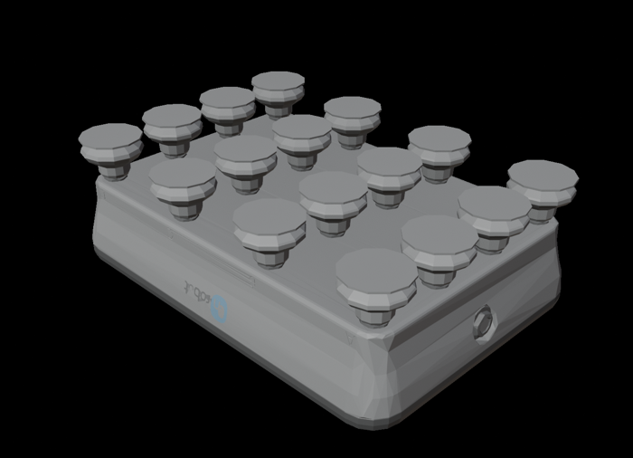
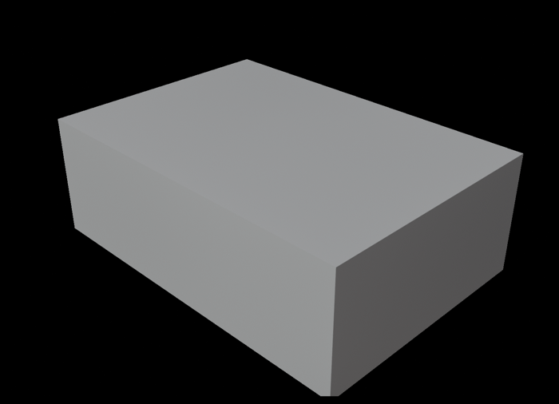

# OnRobot vacuum gripper

This package contains the URDF files describing OnRobot vacuum grippers (VG10, VGC10 and VGP20).

```
roslaunch onrobot_vg_description disp_vg10_model.launch  
roslaunch onrobot_vg_description disp_vgc10_1cup_model.launch  
roslaunch onrobot_vg_description disp_vgc10_4cups_model.launch  
ros2 launch onrobot_vg_description disp_vgp20_model.launch.xml
```

## Visual and Collision models
### VG10
    

### VGC10 (1 suction cup)
    

### VGC10 (4 suction cups)
    

### VGP20 (16 suction cups)
    

`onrobot_vgp20_macro.xacro` splits the gripper so its cups can be swapped:
`onrobot_vgp20_base` is the body (`vgp20_base_link`, on the robot flange, z out
of it) with a `vgp20_cup_mount` frame on its cup face; `onrobot_vgp20_16cups`
hangs the cups (`suction`, origin at the cup lips' centre, the TCP) off that
frame. `onrobot_vgp20` is both. Another cup set is another macro that attaches
its own `suction` link to `vgp20_cup_mount`. Collision is boxes.

## Reference
- To generate a collision model, you can use [rosmodelgen](https://github.com/takuya-ki/rosmodelgen)
